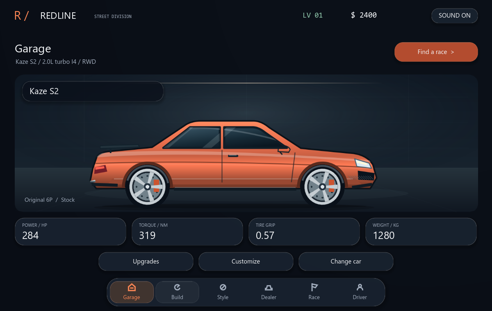
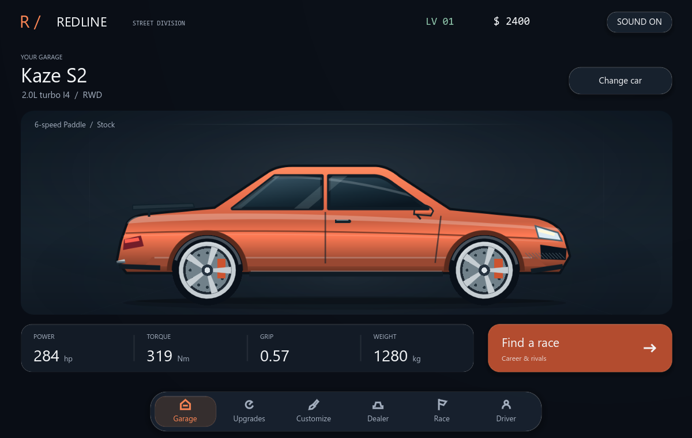
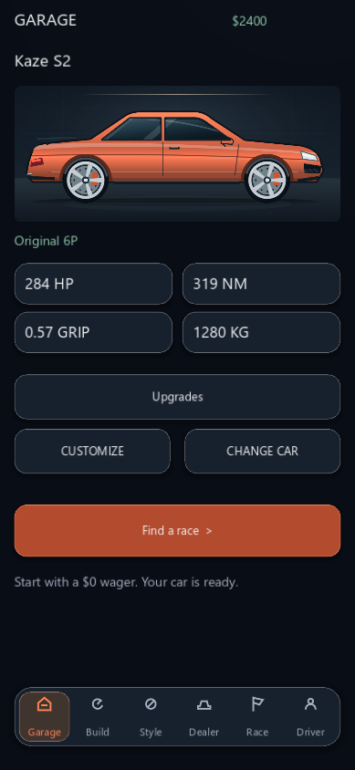
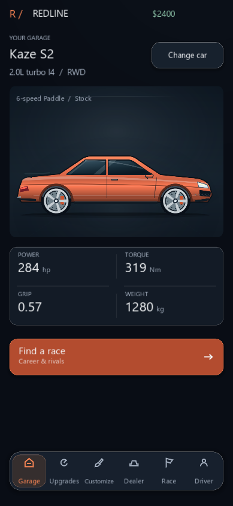

# REDLINE — Garage layout refinement

Upgrade navigation and part comparisons were subsequently redesigned. See `UPGRADE_STUDIO_REPORT.md` for the latest upgrade implementation and validation.

Implemented in the existing project following feedback on the first glass UI pass.

- Removed the Garage's Upgrades and Customize shortcut buttons on desktop and phone. Their sole visible menu entries are now the bottom navigation tabs. Existing upgrade/customization actions and saved data remain compatible.
- Renamed the dock's Build and Style labels to Upgrades and Customize. Replaced the ambiguous crossed-circle customization icon with a brush, fitted phone labels to their actual width, and softened the selected-tab treatment.
- Made the selected vehicle name the main heading. Removed the repeated name badge and large Garage heading. Change Car sits beside the vehicle identity.
- Enlarged the desktop car preview and replaced the hard showroom grid/floor seam with restrained ambient lighting.
- Replaced four button-like stat pills with one read-only statistics strip, including clear units and separators. Values still come from the active simulated vehicle.
- Kept one prominent Find a Race action and the existing context-specific results actions. The garage no longer has a secondary row of navigation buttons.

## Verification

Godot 4.6.3 import and ten regression scripts passed: glass UI, new-player gameplay loop, customization UI, owned garage/builds, upgrade UI, menus/wagers, dealership, racing controls, race flow, and physics. Final branding was also checked by another import, glass UI audit and native screenshot capture.

The glass audit passed 25,881 assertions over five window sizes. It now explicitly checks that duplicate Garage shortcuts are absent, both bottom navigation entries work through actual mouse/touch events, and Change Car and race entry remain available. Counts differ from the previous report because removing controls removes their pairwise layout comparisons. The end-to-end progression test passed 4,873 assertions. All checks use isolated test saves.

Physics remains unchanged: 57,917 assertions, no failures; the canonical stock quarter-mile is still 13.21926575345 seconds at 109.85253018 mph. No simulation, purchase, tuning, reward or ownership implementation was replaced.

The final source package is also clean-import checked with the UI, gameplay loop, dealership, upgrade, wager, customization, garage, flow and shutdown tests. Results are in `final_ui_package_results.json`.

Native desktop and simulated phone-window captures were visually reviewed. Physical iPhone performance and touch ergonomics still require device testing. This pass improves the garage and shared navigation; it does not claim that every part of the game is commercially finished.

## Screenshots

| View | Previous glass layout | Refined layout |
| --- | --- | --- |
| Desktop |  |  |
| Phone |  |  |
