# REDLINE — Liquid Glass UI validation

The current upgrade experience is documented in `UPGRADE_STUDIO_REPORT.md`; the report below records the earlier visual overhaul.

The Garage and shared navigation were subsequently refined after feedback. See `GARAGE_REFINEMENT_REPORT.md` for the latest layout, shortcut removal and current test results; the counts below describe the original glass overhaul.

Implemented in the existing Godot 4.6.3 project. Vehicle physics, transmissions, AI, ownership, economy, race logic and installed upgrade data remain on the existing systems.

## Implemented

- Shared dark glass palette, cached rounded StyleBox surfaces, quiet edge reflections and shadows. Orange is concentrated on primary actions and selection accents; secondary actions use neutral glass. Text remains opaque.
- A compact floating dock replaces the six wide bottom rectangles. Its native PanelContainer, MarginContainer and HBoxContainer share the existing action map, with no second event handler. It adapts to the logical phone/desktop canvas and existing safe-area transform.
- Garage showroom framing, a vehicle information overlay, smaller actions and labeled performance cards. A single prominent Find a Race action remains.
- Fifteen compact upgrade cards with original procedural mechanical icons and no numbering. One overview and its existing category windows remain the only upgrade route.
- Adaptive phone sheets and desktop two-column details with cached background frosting, segmented sections, visible ownership/compatibility states, and protected purchase/install actions. Background hit targets and the dock are removed while a sheet or expanded graph is open.
- A live mini dyno inside stage details, plus the overview and expanded analysis view. Curves still sample actual full-throttle engine torque every 50 RPM, using HP = Nm × RPM / 7127. Installed curves are solid; compatible previews are dashed. Line brightness transitions without interpolating or inventing performance values. Non-engine upgrades retain identical output curves.
- Race board cards, a larger opponent preview, concise performance/reward information, and matching desktop/phone wager sliders. The slider uses its registered range rather than fixed old screen coordinates.
- Shared hover highlights, short press feedback, sheet entrance motion, moving dock selection, and graph brightness transitions. Actions remain usable during transitions. Back/Close acts immediately, without a blocking animation.
- Keyboard menu focus: Tab / Shift+Tab, Enter or Space to activate, Escape to return. Driving inputs are unchanged.
- Reduced motion is available in Driver and persists in the existing save schema with a default of false for old saves. Low effects skips backdrop allocation. The F6 development comparison shows rectangular surfaces and the original dock arrangement; it does not revert gameplay or the redesigned content layouts.

## Corrections found during review

- Prevented invalid or unaffordable stage, component, gearbox, cosmetic and vehicle purchases from pointer activation; retained the existing model checks as a second safeguard.
- Disabled unavailable pagination, completed vehicle selection, unsupported tuning and locked race actions consistently.
- Removed duplicated Dyno actions within the same upgrade view.
- Corrected physical-key recognition for Tab and F6; Enter without menu focus no longer unexpectedly leaves an upgrade screen for racing.
- Updated the old wager interaction test to find the actual control, preserving its full-stake drag, release, debit and double-charge assertions.
- Fixed native dock content margins, rounded panel styling, and icon/label separation after reviewing screenshots.
- Reduced the overview graph height so its RPM caption and peak output cannot overlap. Replaced individual short strokes with antialiased polyline curves and cleaner preview dashes.

## Verification

The full 30-entry racing validation suite passed. Final visual refinements were also rechecked with import, the glass UI audit and garage/dyno tests; the packaged project is checked separately from a clean extraction.

| Check | Result |
| --- | --- |
| New glass UI audit | 25,989 checks, passing, including primary-label contrast of at least 4.5:1 |
| Responsive sizes | 1200×760, 1440×900, 390×844, 360×780, 844×390 |
| Layout/action coverage | All major menus, all 15 categories, components, tuning and four gearbox families; unique non-overlapping targets; native dock alignment; modal isolation |
| Input and persistence | Mouse/touch purchase, preview isolation, slider drag/release, keyboard focus, disabled actions, safe-area mapping and saved reduced motion |
| Physics regression | 57,917 checks, zero failures |
| Transmission/parts regression | 45,062 checks, passing; 204 comparison runs |
| New-player loop | Race → rewards → upgrade → four recovery races → buy another car → switch/reload; 4,957 checks, passing |
| Stock quarter mile | 13.21926575345 s at 109.85253018 mph, unchanged |
| Upgraded quarter mile | 10.00111334044 s at 151.60636789 mph, unchanged |
| Live physics/audio | 30/60/120/144 render caps; no steady-state underruns or safety clamps during samples; 16 startup/prior underruns recorded |
| Style allocation | Cache count remains stable over repeated idle redraws |
| Clean delivery | 21 gameplay/import checks passed from a clean extraction; final palette and arrow-state refinements also passed 8 packaged UI/import/flow checks from another unused extraction |

Tests run in isolated user-data directories. Existing personal save files are not test fixtures. Native Windows rendering, real scene instantiation, injected mouse/touch/key events and simulation-driven races are exercised, not just static mockups.

## Performance and remaining device work

Medium/High capture and downsample one background image when a detail sheet opens. This is a cached frosted approximation, not physically refractive glass or continuous live blur. No per-button blur, screen sampler, particle system or third-party UI/audio asset was added. Low uses tint only. The existing custom-drawn menu architecture is retained; the dock uses native responsive containers.

The opening capture causes one GPU readback. Its latency, sustained frame rate, memory use, physical touch ergonomics, iPhone font substitution, and safe-area behavior still require real iOS/low-end device testing. Windows render-cap checks are not measurements of phone performance or guaranteed achieved FPS. Subjective audio quality and output-device latency remain human checks. No claim of matching Apple's proprietary rendering implementation is made.

## Theme files

- `scripts/glass_palette.gd` / `assets/ui/liquid_glass.tres`: palette, tint, radius, shadow, blur amount and motion duration.
- `scripts/liquid_glass.gd`: shared drawing, state cache, frosting and restrained interaction feedback.
- `assets/ui/glass_theme.tres`: native Control styles.
- `scripts/glass_dock.gd`: responsive dock and active selection.
- `tests/test_glass_ui.gd`: interaction/layout regression audit.
- `tests/capture_ui.gd`: repeatable matched screenshots. `--before` was captured before implementation; running that option now captures the current build, not a historical reconstruction.

## Matched screenshots

Captured from the same fresh Kaze S2 build, $2,400 balance and window sizes. These are native game renders. The original screenshots are preserved alongside the new captures.

| Screen | Before | After |
| --- | --- | --- |
| Garage / desktop | 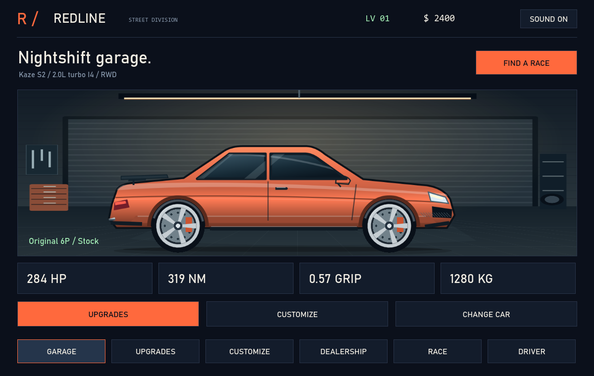 | 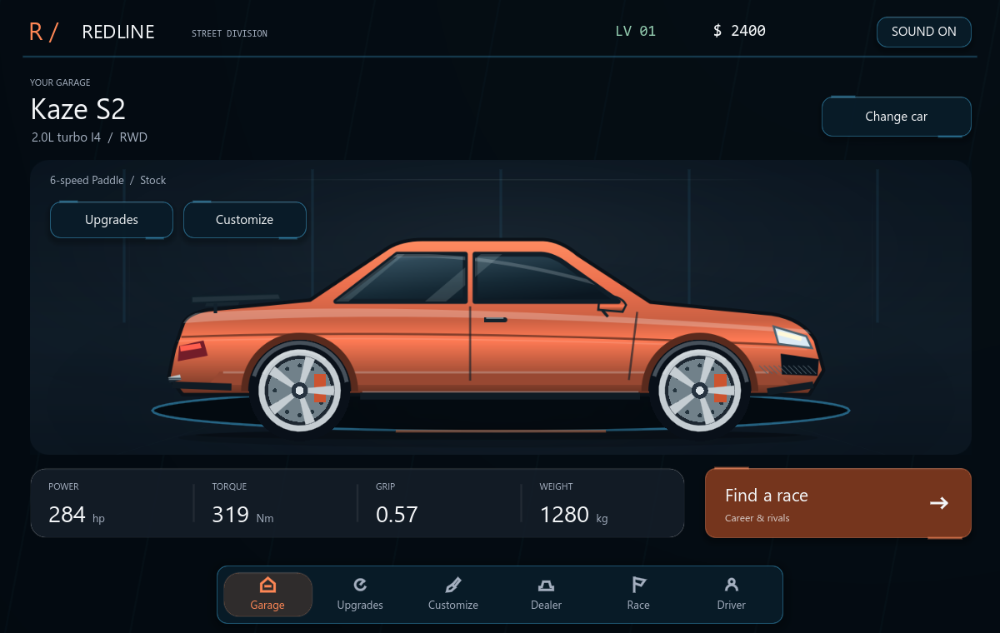 |
| Upgrades / desktop | 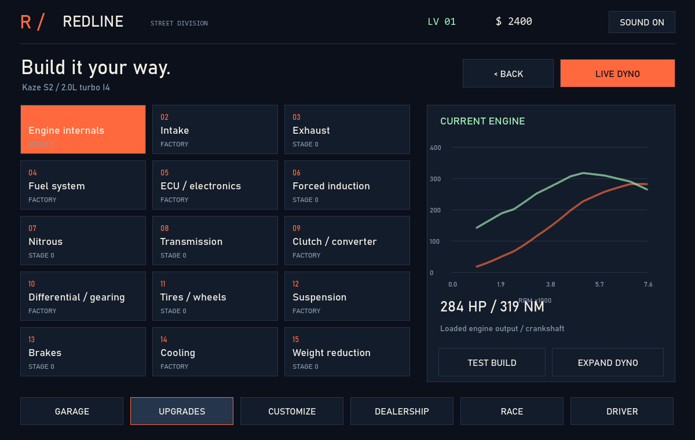 | 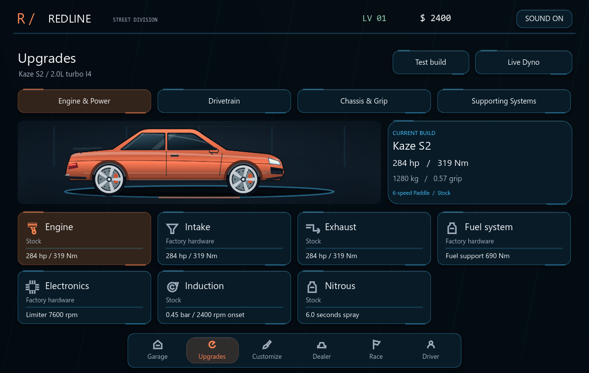 |
| Detail / desktop | 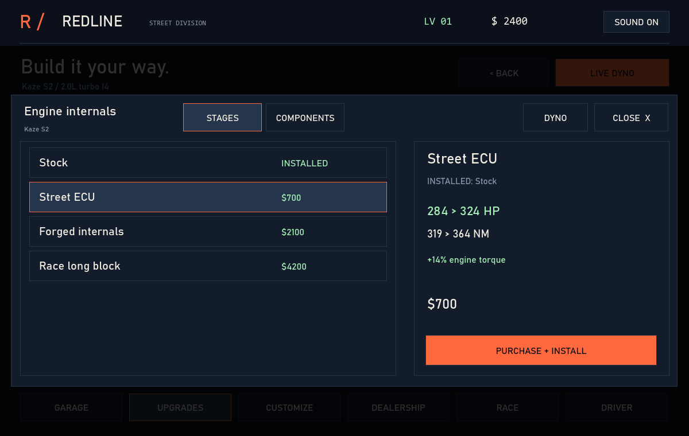 | 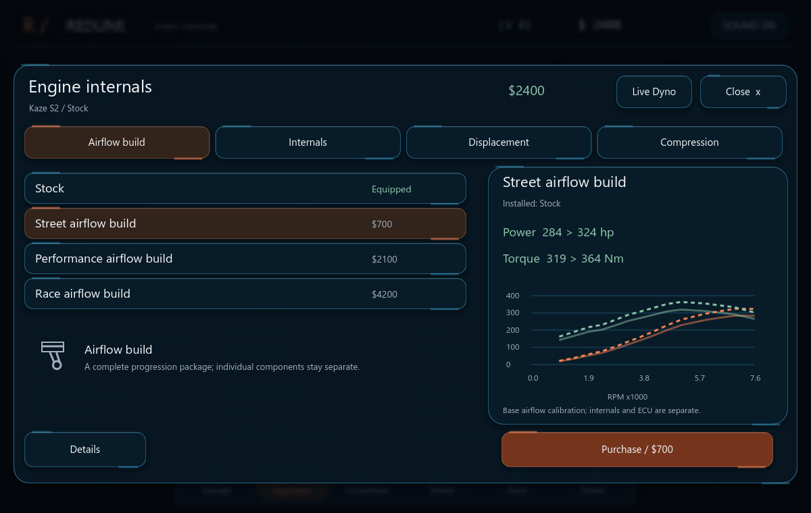 |
| Race board / desktop |  | 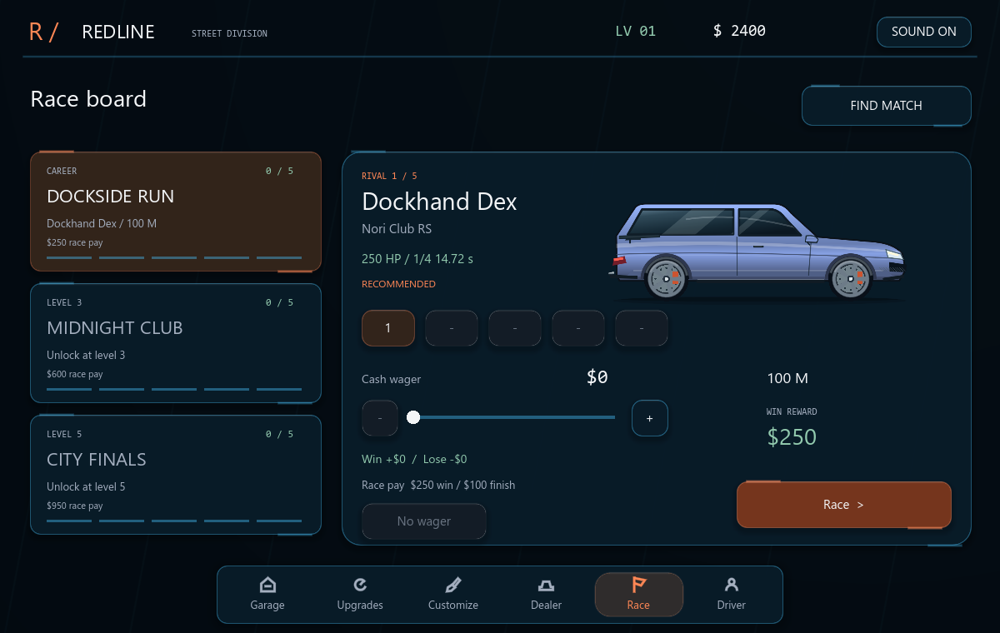 |
| Garage / phone | 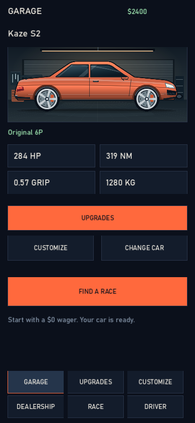 | 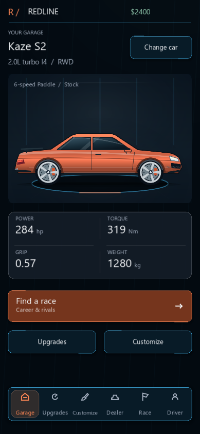 |
| Upgrades / phone | 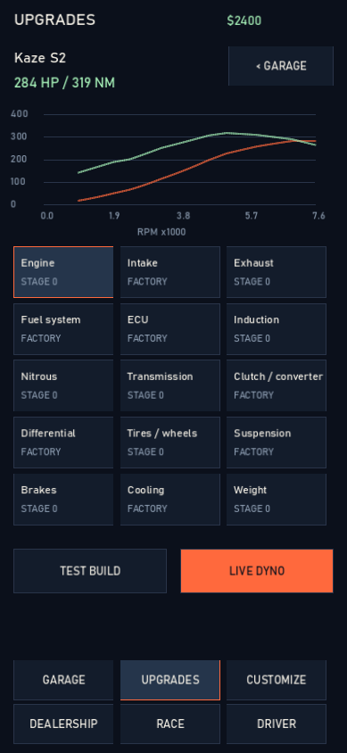 | 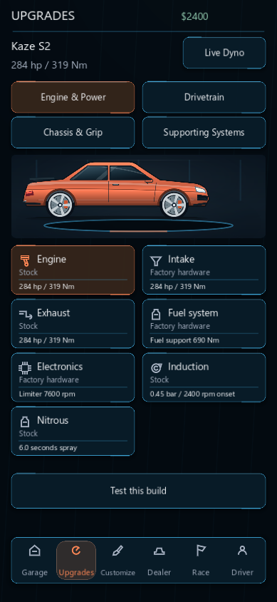 |
| Detail / phone | 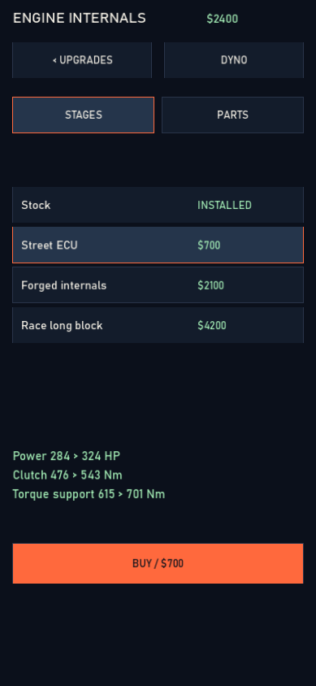 | 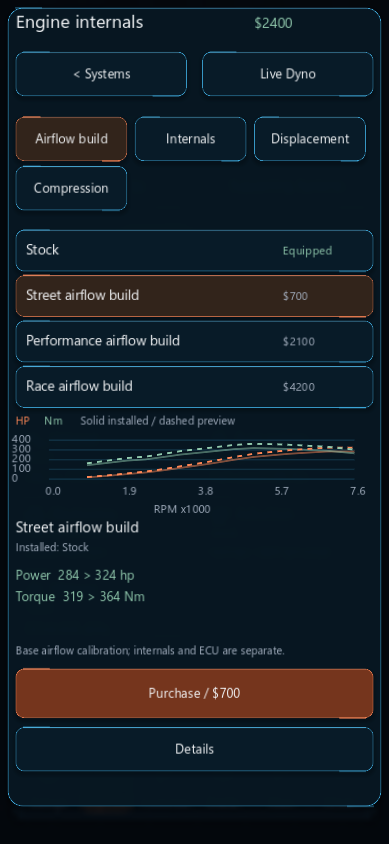 |
| Race board / phone | 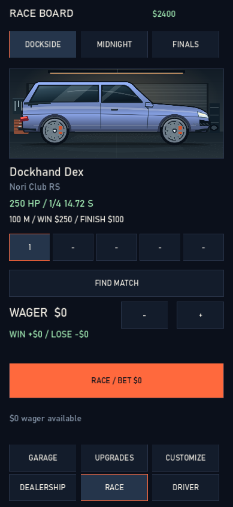 | 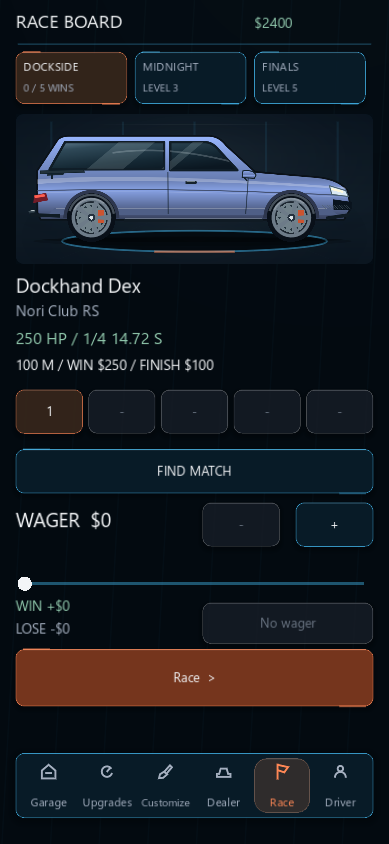 |
