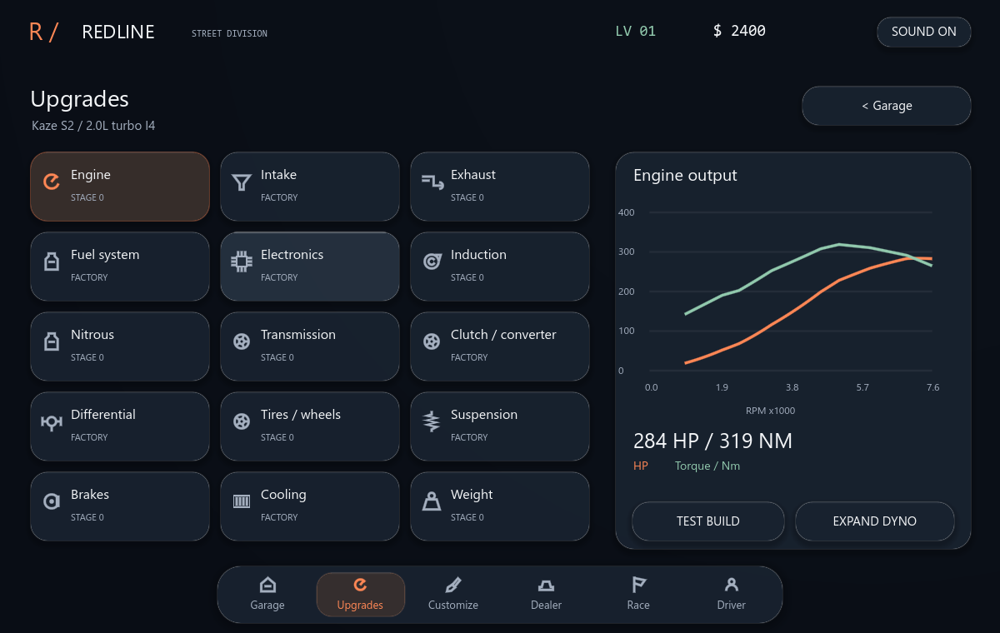
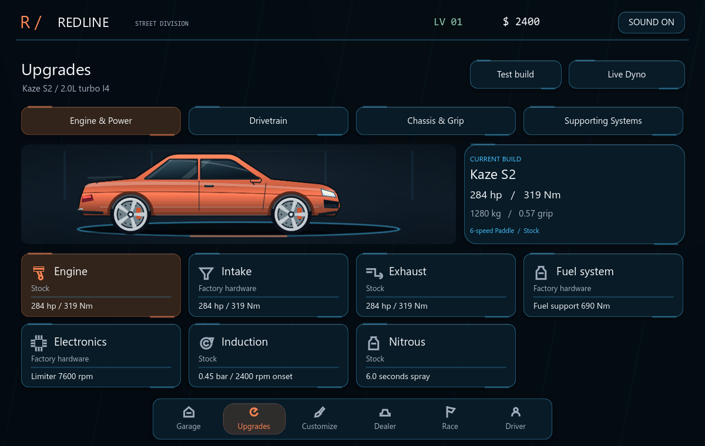
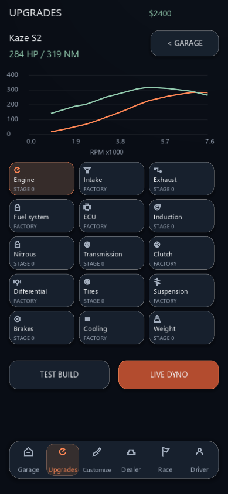
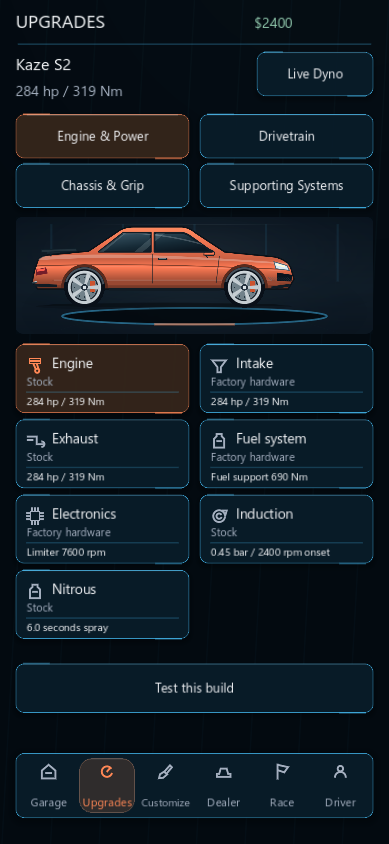
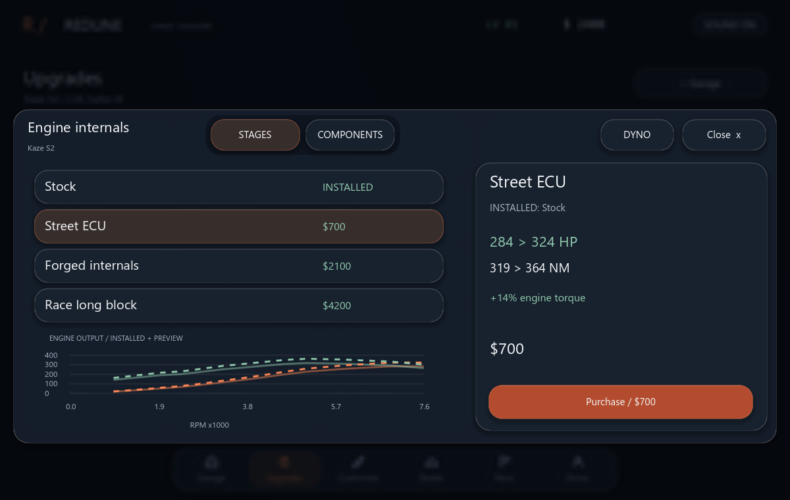
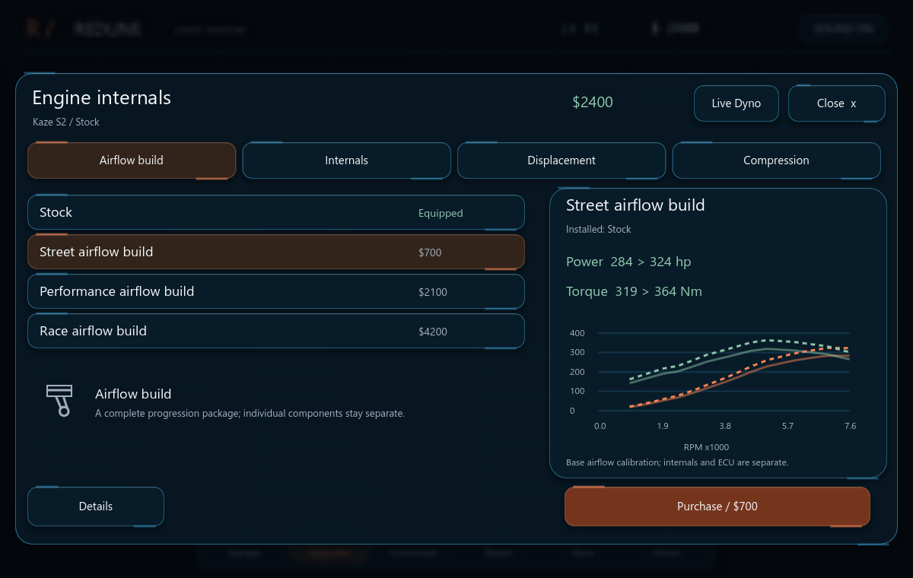
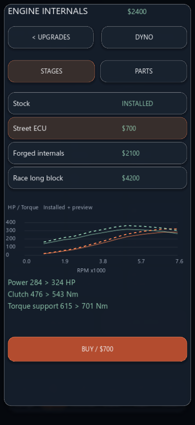
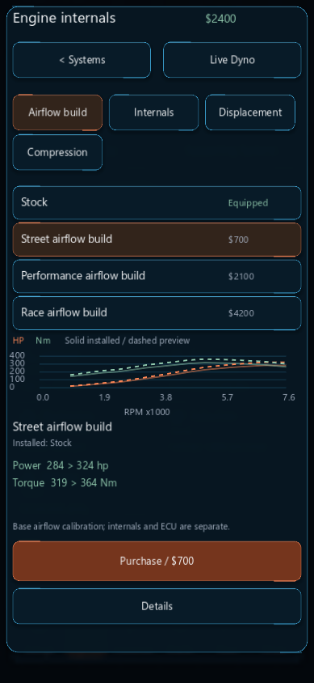

# REDLINE — Upgrade Studio

## Implemented

The existing upgrade system now has four system selectors: **Engine & Power**, **Drivetrain**, **Chassis & Grip**, and **Supporting Systems**. All 15 existing categories, 34 mechanical parts, eight package progressions, and 21 gearbox configurations remain accessible. Screens do not introduce a second purchase or save system.

Categories open one adaptive component sheet. Named choices such as Airflow Build, Internals, Displacement and Compression replace the ambiguous Stages/Components split. Transmission internals, complete gearboxes, shift hardware, ratio cassettes, transbrakes and tuning remain separate mechanical purchases. Back restores the selected component and option, as well as the system group.

The overview no longer reserves half the screen for an unrelated dyno. It shows installed build status and a relevant current specification per category. The detail sheet shows the installed part, selected replacement, price, requirements, and actual before/after parameters. A stable purchase/install footer distinguishes Equipped, Included, Owned, Available and Locked options. One-page lists do not show pointless pagination. Single-component categories omit redundant selectors.

Engine power changes get actual torque/horsepower overlays; the phone package view has a compact plot, and Live Dyno remains accessible from every sheet and the overview. Gearbox/chassis/weight/cooling previews use relevant mechanical values and asynchronous same-condition quarter-mile estimates instead. The estimates use the same Drivetrain and AI driver, zero reaction delay and no nitrous, with existing shift optimization and traction decisions. They are estimates from an assisted driver, not guarantees for a player's launch. Forecasting runs on separate instances and never changes a live car, currency or saved build.

Positive changes are restrained green; losses are muted red; unchanged values and tuning tradeoffs stay neutral. In particular, more gears, a larger wheel radius or a higher converter stall are not automatically marked as improvements. Original procedural piston and other component icons complement the existing glass materials without copying reference artwork.

## Mechanical corrections

| Problem | Correction |
| --- | --- |
| A hybrid/race turbo added capacity on top of another turbo package | A fitted assembly owns its boost curve, onset and response. The package remains the fallback when the assembly is removed. The hybrid has 0.32 bar added capacity relative to factory base boost; the large-frame assembly 0.80 bar, with later onset and slower response. They are documented game calibrations, not measured compressor maps. |
| Several clutch packs saturated the same input-capacity cap | Pack capacity now approaches the gearbox rating progressively, so twin and race packs have distinct actual coupling limits. The gearbox remains the upper limit. |
| Fuel and strength constraints only applied to “advanced” builds | Both legacy and advanced builds now use the same fuel/strength ceilings. Fitting an unrelated component can no longer switch those constraints on. |
| Raising turbo stage also manufactured engine strength | Mechanical torque support follows the factory rating, engine build and fitted strength parts, not the requested boost stage. |
| Both FWD suspension packages used the same transfer setting | Street and drag FWD setups now use 0.12 and 0.08 transfer response, reducing front-axle unloading distinctly; RWD behavior is preserved. |
| Engine “Street ECU” stage looked like a duplicate programmable ECU | Engine package names now describe airflow builds. Packages calibrate the torque curve; programmable ECU hardware unlocks launch/limiter tuning; forged parts add support, inertia and RPM headroom. They are different functions rather than two ECUs silently adding the same benefit. IDs, purchases and stage values are unchanged. |
| Owned lower package levels jumped forward when selected | They remain selectable as Included, show the current installed build, and cannot downgrade or charge again. |
| Locked parts could look like zero-gain upgrades | They show their available specifications and requirement, without presenting an illegal build as a valid performance forecast. |
| Conversion preview could disagree with the installed gearbox | It now applies the same performance-stage restoration, gearbox-specific part removal and tuning reset as an actual conversion. Previously purchased hardware remains owned. |

Fuel systems honestly show capacity/headroom; they do not fabricate stock horsepower gains. Stronger internals require ECU control to use additional mechanical RPM headroom. Cooling increases heat rejection and mass, so it can slightly slow a cold short run while helping sustained heat. Tire compounds remain separate from wheel/carcass geometry and inertia. Nitrous displays requested nozzle enrichment, bottle duration and the actual torque ceiling rather than an unconditional horsepower promise.

Prices were retained. The first engine package remains $700; higher targets use the existing cumulative incremental price calculation. Reinstallation of compatible owned parts is free. Gearbox-specific fitments retain the existing per-gearbox ownership rules, and the UI now explicitly says when a part owned for another gearbox needs a new fitment.

Boost controllers now require a turbo source and remain inactive for belt-driven superchargers. Invalid purchases are rejected before charging; existing ownership is preserved. Boost tuning is bounded by the installed source. Programmable limiter storage now matches actual mechanical RPM headroom, and raising the limiter no longer stretches the torque curve or changes centrifugal-supercharger pulley behavior.

## Model approximations and audit

The engine/exhaust packages still use calibrated, lumped airflow/torque coefficients; the project does not model individual cam lobes, combustion chambers or measured compressor maps. Strength, fuel support, thermal response and effective axle grip are also gameplay approximations. They are connected to the real simulation but are not proprietary formulas recovered from The Strip. No fuel-range items or other upgrades with unimplemented mechanics were copied from the reference.

`UPGRADE_PARAMETER_AUDIT.md` and `upgrade_parameter_audit.json` contain actual before/after data for every component and adjacent package level: **60 configurations** in total. Values include torque/horsepower, mass, inertia, RPM limits, boost, response, capacities, grip, cooling and control unlocks. Required supporting parts are held constant when measuring an individual component.

## Reference material actually inspected

- New full-resolution screenshots IMG_2284 through IMG_2288: fuel, tires, ECU and turbo choices. Their useful patterns are explicit installed status, concise mechanical benefits, clear prices, and custom configurations with tradeoffs. REDLINE keeps its own appearance, ownership rules and original artwork.
- PCZN6749.MP4: 65.962-second upgrade/tuning walkthrough from The Strip. Thirty-two frames across the recording were decoded and inspected, covering fuel cells, ECU limiter/ignition/boost tuning and multiple induction architectures. It is reference-game footage, not a REDLINE walkthrough.
- HODY6554.MP4: 32.147-second race recording, approximately 59.975 fps. Thirty-two frames across the recording and enlarged upright HUD frames were inspected. Its stereo 48 kHz PCM soundtrack was decoded for RMS/spectral-window analysis. The mixed audio was not isolated into an engine track or used as a game asset; waveform measurements are not an audible timbre assessment.
- The local `Game/` directory was empty when checked, including at final validation. The approximately one-minute REDLINE menu recording therefore could not be inspected. Existing REDLINE problems were audited through its implementation, native rendered screens and interaction tests instead.

Observed reference HUD samples are in `new_reference_observations.csv`. Examples: race clock 3.433 s, gear 2, 7,680 RPM, 75 mph; at 4.450 s, gear 3, 5,520 RPM, 84 mph; at 5.450 s, gear 4, 5,850 RPM, 111 mph. These are sparse samples, not exact before/after shift points. The slip shows reaction 1.046 s + ET 8.579 s = total 9.625 s, with 177 mph quarter-mile trap. That timing convention agrees with REDLINE's reaction-excluded ET plus green-to-finish total.

The reference car's final installed configuration after the earlier tuning previews is unconfirmed. Its 8.579-second result is not a valid stock-Kaze calibration target. Exact shift duration, clutch slip, isolated engine pitch, output latency and subjective driving/audio similarity could not be established from these samples. No unsupported racing-physics changes were made to chase that time.

## Validation

- Full **32-entry** regression suite passed, including 204 transmission comparison runs and the existing physics, controls, AI, progression, dealership, ownership, saves, customization, staging and audio checks.
- Upgrade model: **4,672 assertions**, including turbo replacement, peak/lag tradeoffs, distinct clutch packs, engine/fuel ceilings, FWD suspension, all 34 parts, dependencies, headroom, purchase/reinstallation and save continuity.
- Upgrade Studio UI: **82 assertions** with native desktop and phone-window renders, all 15 grouped categories, real touch-event navigation, preview isolation, preview/install parameter parity, retained selection, gearbox conversion and non-engine comparisons.
- Glass/layout audit: **23,607 assertions** across five window sizes; current counts reflect removed redundant selectors and pagination. The audit covers overlaps, unique hit targets, modal isolation, mouse/touch/keyboard access, safe areas and reduced motion.
- New-player loop: **4,307 assertions**, including real simulation-driven keyboard races, rewards, buying/installing an upgrade, four recovery races, purchasing another car, switching and reloading.
- Coupled physics: **57,917 assertions**, zero failures. Stock quarter-mile regression remains 13.21926575345 s at 109.85253018 mph; the canonical upgraded fixture remains 10.00111334044 s at 151.60636789 mph. Modified hardware configurations can intentionally differ after the corrections above.
- Runtime audio/physics at 30/60/120/144 render caps: zero steady-state audio underruns or safety clamps in sampled runs; 19 startup/prior underruns were recorded. The cap is not a measurement of guaranteed achieved FPS.

Final UI refinements were separately rechecked with import, upgrade-model, Studio UI, layout, new-player, upgrade and wager-menu tests. The delivered source is also checked from a fresh extraction, with a matching source fingerprint recorded in `final_ui_package_results.json`. Test saves are isolated from the player's actual save directory.

Remaining manual work: physical phone performance/safe-area/font verification, touch comfort, subjective visual and audio feel, and review of the missing REDLINE walkthrough when it is supplied. Exact reference-engine parameters and formulas remain unknown.

## Screenshots

The before images are extracted from the actual previously delivered build. New overview/default screenshots use the fresh Kaze build; detailed test captures use clearly separate funded QA builds so all options can be reviewed.

| Screen | Previous | Redesigned |
| --- | --- | --- |
| Desktop overview |  |  |
| Phone overview |  |  |
| Desktop part view |  |  |
| Phone part view |  |  |

Additional native captures in `upgrade_studio/` show all four systems, internals, gearbox conversion, weight, cooling and the expanded dyno, on both desktop and phone layouts.

